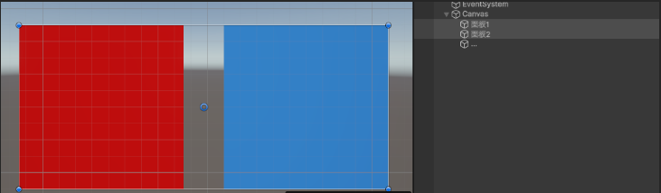
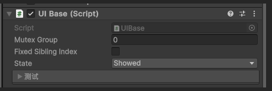

# UIManager 📱

UIManager 是一款简洁高效的 Unity UI 界面管理插件，专注于提供便捷的 UI 显示隐藏管理功能。

## ⚙️ 安装指南

将以下依赖添加到项目的 `manifest.json` 文件中：

```json
{
  "dependencies": {
    "com.jh.jtask": "https://gitee.com/wmzjzxyh/jtask.git",
    "com.jh.jtween": "https://gitee.com/wmzjzxyh/jtween.git",
    "com.unity.ugui": "2.0.0",
    "com.jh.uimanager": "https://gitee.com/wmzjzxyh/uimanager.git"
  }
}
```

## 🚀 快速开始

### 1. UI 结构设计

在常见项目中，UI 通常以面板为单位进行管理，每个面板包含多个元素，形成层级结构：



您可以根据自己的需求搭建类似结构的 UI 界面。为了便于区分，建议给不同面板设置不同的颜色或标识。

### 2. 配置 UI 面板组件

#### 核心组件

每个 UI 面板需要两个关键脚本：

| 脚本类型 | 功能描述 | 必要性 |
|---------|---------|--------|
| `UIBase.cs` 或其子类 | 负责 UI 的核心显示隐藏逻辑 | ✅ 必需 |
| 行为控制器脚本 | 实现具体的显隐效果 | ✅ 必需 |

#### 内置行为控制器

| 控制器名称 | 功能描述 |
|-----------|---------|
| `AlphaEffectController.cs` | 通过调节透明度实现显隐效果 |
| `RectEffectController.cs` | 通过修改 Transform 实现显隐效果 |
| `VertUIFlowController.cs` | 实现复杂的 UI 流式显隐行为 |

#### 挂载步骤

1. 选择 UI 面板，添加 `UIBase.cs` 组件
2. 添加一个行为控制器组件（如 `AlphaEffectController.cs`）

#### 互斥组标识

添加 `UIBase` 后，Hierarchy 面板中会显示带颜色的标识：

标识格式为 `互斥组/抢占优先级 状态`：

- **互斥组**：只有同一直接父节点且组号相同的 UI 会发生显示互斥
- **抢占优先级**：同父同组内，数值严格更高且正在持有显示权的 UI 可以拒绝低优先级请求，默认为 `0`
- **字母 H**：表示此面板当前处于 `Hided` 或 `Hiding` 隐藏生命周期
- **字母 S**：表示此面板当前处于 `Showing` 或 `Showed` 显示生命周期

#### 设置初始状态

在 Inspector 面板中找到 UIBase 组件，修改 State 属性：



#### 设置随父显示

直接子 UI 勾选 `Show With Parent` 后，会在直接父 UI 的显示行为完成后自动显示。未勾选的直接子 UI 保持原状态；多层 UI 可以在每一层分别配置并继续向下级联。

父 UI 自动显示子 UI 时，子 UI 仍会执行完整的同步或异步显示生命周期，但不会再次向上显示父链，因此无需通过显示事件手动联动父子面板。

#### 设置外部直接显示的父链策略

`Parent Show Policy` 默认为 `Auto Show Parent Chain`，保留原有行为：外部直接显示子 UI 时，UIBase 会从连续 UI 父链的最上层祖先到直接父 UI 依次补齐显示生命周期；遇到未挂载 `UIBase` 的普通 Transform 后停止向上扫描。

配置为 `Require Parent Chain Showed For Direct Show` 后，当前 UI 的直接父 Transform 必须挂载 `UIBase`，并且连续父 UI 链必须全部已初始化、处于激活层级且状态为 `Showed`，才接受 `Show()` 或 `ShowAsync()` 的外部直接请求。缺少直接父 UI 或被准入拒绝时，不会改变状态、隐藏兄弟或触发显示事件。

`Show With Parent` 仍属于父 UI 自身显示事务的级联步骤，不受上述“外部直接显示”父链条件限制，但仍遵守同组抢占优先级。

### 3. 运行与测试

运行程序后，您可以通过 UIBase 脚本的上下文菜单测试 UI 的显隐行为：


## 📚 API 参考

UIBase 提供了以下核心 API：

| 成员 | 描述 | 返回值 |
|------|------|--------|
| `Show()` | 直接显示 UI 面板 | void |
| `Hide()` | 直接隐藏 UI 面板 | void |
| `ShowAsync(CancellationToken)` | 异步显示 UI 面板 | JTask |
| `HideAsync(CancellationToken)` | 异步隐藏 UI 面板 | JTask |
| `ShowWithParent` | 获取或设置当前 UI 是否随直接父 UI 显示 | bool |
| `ParentShowPolicy` | 获取或设置外部直接显示时的父链策略 | UIParentShowPolicy |
| `MutexPriority` | 获取或设置同父同组 UI 的抢占优先级 | int |

> 💡 注意：`JTask` 可视为等同于 .NET 中的 `Task` 使用。异步显隐被取消时会向调用方抛出 `OperationCanceledException`，调用方应按标准异步取消流程处理。

## ⚠️ 使用注意事项

1. **互斥组规则**：互斥只作用于同一直接父节点且组号相同的 UI；不同父节点的相同组号不会互相影响
2. **层级管理**：同一父节点下的不同互斥组 UI 可以同时显示，最后显示的面板会自动置顶
3. **自定义行为**：您可以通过继承现有控制器来实现自定义的显隐效果
4. **动态关系**：父、子和兄弟 UI 关系以当前 Transform 层级为准；运行时新增、移除或换父后，无需维护额外邻接表
5. **随父显示范围**：`ShowWithParent` 只作用于直接子 UI；父 UI 已经处于 `Showed` 时重复调用 `Show()` 不会恢复被手动隐藏的子 UI
6. **默认子 UI 互斥**：需要同时显示的多个默认子 UI 必须配置为不同互斥组，同组节点仍遵守原有互斥规则
7. **抢占优先级**：高优先级只在已显示、正在显示或有效隐藏操作仍在执行时阻止同组低优先级；已隐藏的高优先级 UI 不预占组，相等优先级保留“后请求获胜”行为。隐藏被取消或失败后不会继续占权，后续获准请求会把残留过渡状态收口为 `Hided`
8. **拒绝不等于取消**：准入仲裁拒绝的 `ShowAsync()` 会正常结束且不产生副作用；如果调用方必须区分“显示成功”与“被拒绝”，应在任务结束后检查 `State`

## 🔍 示例项目

您可以通过 Unity Package Manager 导入示例项目，查看更多使用场景：

1. 打开 Package Manager
2. 找到 UIManager 包
3. 点击 "Samples" 选项
4. 导入示例项目

## 🔧 进阶配置

想要了解更多高级功能和配置选项，请参考：
- 完整 API 文档
- 源代码注释
- 示例项目中的场景示例

---

📢 如有任何问题或建议，欢迎通过 [Gitee 仓库](https://gitee.com/wmzjzxyh/uimanager) 提交 Issue 或 Pull Request！
